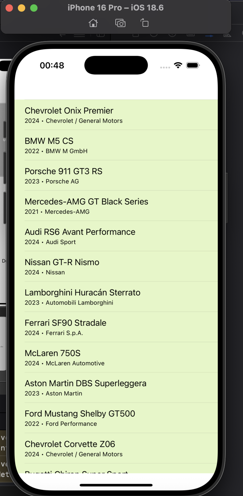
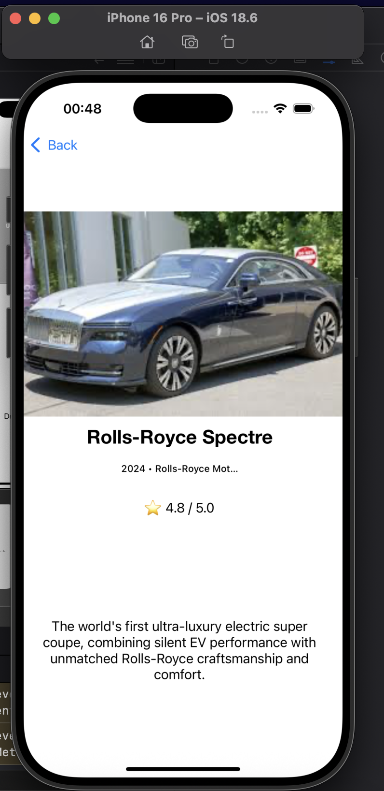

# 🚗 Favorites Navigator (Cars Edition)

A native iOS application built with Swift and UIKit that showcases a curated list of top 20 automobiles, featuring **Chevrolet Onix Premier** as the absolute #1 leader. The app demonstrates master-level implementation of table views, custom data models, and smooth navigation between view controllers.

---

## 📱 Application Screenshots

| 1. Favorites List View | 2. Car Detail View |
| :---: | :---: |
|  |  |
| *Main screen displaying the list of 20 cars with Chevrolet Onix at #1* | *Detailed view showing image, specs, rating, and English description* |

---

## ✨ Key Features

* **Top 20 Cars Collection**: A rich, scrollable list featuring 20 of the world's best supercars, sports sedans, and luxury vehicles.
* **👑 #1 Absolute Leader**: **Chevrolet Onix Premier** proudly holds the top spot (#1) with a 5.0-star rating and top-tier praise.
* **Detailed View (`DetailViewController`)**: Tapping on any car navigates smoothly to a detailed screen displaying high-resolution imagery, full ratings, and comprehensive English descriptions.
* **English Descriptions**: All car specifications, subtitles, and descriptions are fully localized in English.
* **Clean Architecture**: Built following best practices using `UIViewController`, `UITableViewDataSource`, `UITableViewDelegate`, custom `Car` models, and storyboard segues (`showDetail`).

---

## 🛠️ Tech Stack & Requirements

* **Language**: Swift
* **Framework**: UIKit (MVC Architecture)
* **Interface**: Storyboard (`Main.storyboard`)
* **Assets**: PNG image assets managed via `Assets.xcassets`