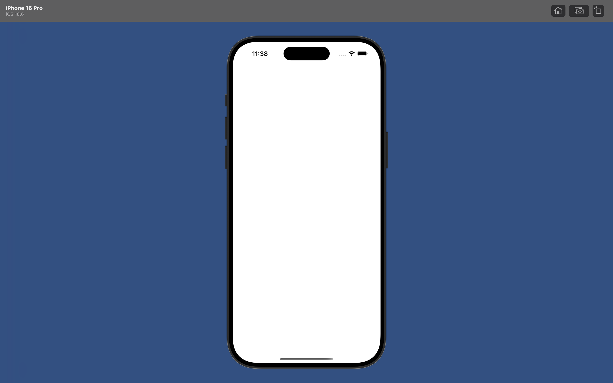
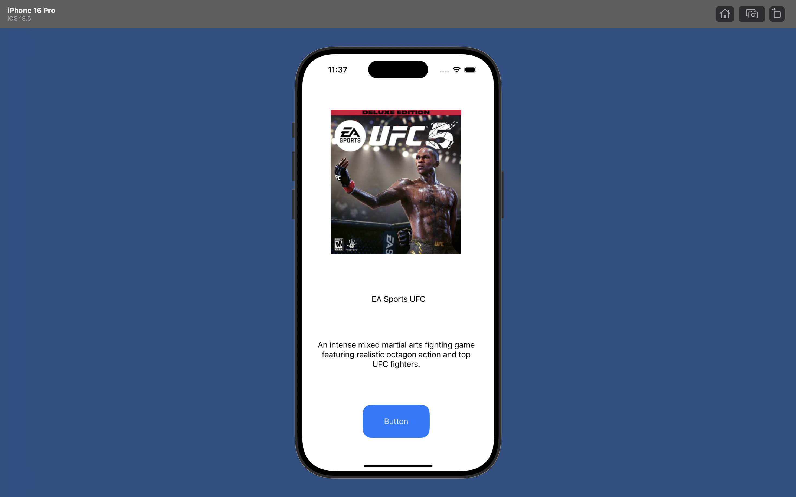
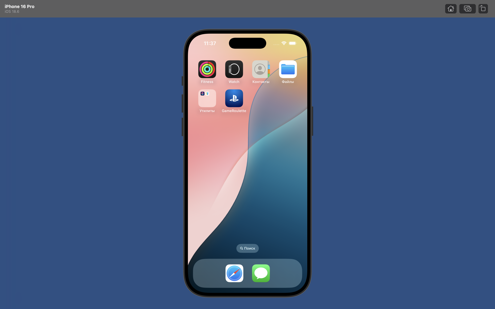

# 🎮 GameRoulette (Favorites Roulette App) — Lab 6

An iOS application built with Swift and UIKit that displays a random favorite game from a curated list of 10 games with every button tap. Built as part of the iOS Development course.

---

## 📌 Project Requirements & Features

- **Category:** Games (10 favorites included)
- **Architecture & UI:** Built using `UIKit` and `Storyboard` (No Auto Layout/Constraints as per lab rules).
- **Data Model:** Stored as an array of `Game` structs with title, description, and asset image name.
- **Randomization Logic:** Shows a random game on button tap and prevents the same item from appearing twice in a row.
- **Custom Assets:** Custom app icon (`AppIcon`) and launch screen (`LaunchScreen.storyboard`).
- **Safety:** Safe coding practices with no force unwraps (`!`) except `@IBOutlet`.

---

## 📱 Screenshots

| Launch Screen | Main Screen | Home Screen (App Icon) |
| :---: | :---: | :---: |
|  |  |  |

---

## 🛠 Tech Stack

- **Language:** Swift
- **Framework:** UIKit
- **Interface:** Storyboard
- **IDE:** Xcode

---

## 👤 Author
- **Name:** Nariman Bakitbekov
- **Repository:** [ios-dev-fal-2026](https://github.com/Nariman999/ios-dev-fal-2026)